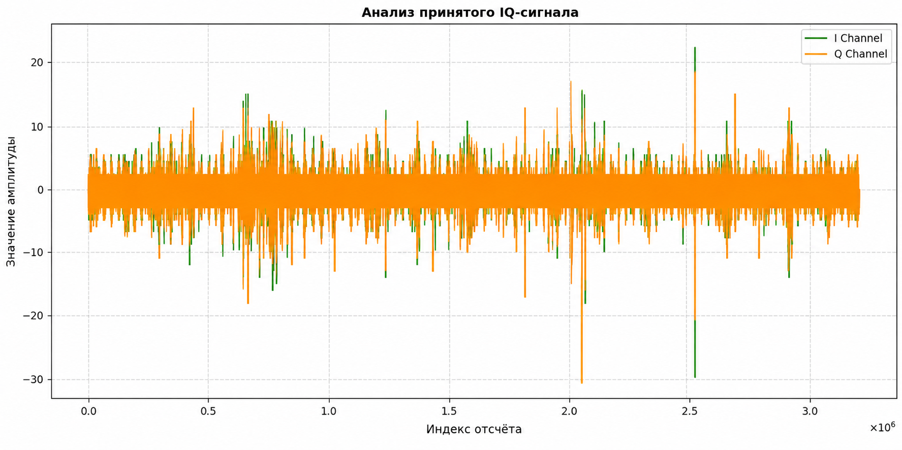

# PracticeSDR — практические работы по SDR

Учебный проект по **Software Defined Radio (SDR)**: знакомство с приёмом FM-сигналов в GNU Radio, обработка комплексных I/Q-отсчётов через SoapySDR и организация совместной работы потоков RX/TX с временными метками.

В репозитории собраны **отчёты по практикам**, **иллюстрации результатов** и **программа на C++** для эксперимента с RX/TX. Для разработки используется Ubuntu / WSL2. Программные примеры с драйвером `plutosdr` требуют совместимого ADALM-PLUTO; без платы доступны изучение исходников, сборка и анализ заранее подготовленных данных.

## Навигация по практикам

| Неделя | Тема | Материалы в репозитории |
|:---:|---|---|
| 1–2 | Архитектура SDR и FM-приёмник в GNU Radio | [Отчёт](reports/week_1_2/README.md) · [Схема](pics/scheme_week_1.png) · [Графики](pics/results_week_1.png) |
| 3 | SoapySDR: настройка RX и запись I/Q-отсчётов | [Отчёт](reports/week_3/README.md) · [График](pics/graph_week_3.png) |
| 4 | SoapySDR: совместная работа RX/TX и timestamp | [Отчёт](reports/week_4/README.md) · [Исходный код](src/main.cpp) · [График](pics/graph_week_4.png) |
| 7 | Материалы ещё не заполнены | `reports/week_7/README.md` |
| 8 | Материалы ещё не заполнены | `reports/week_8/README.md` |
| 9 | Материалы ещё не заполнены | `reports/week_9/README.md` |

> В текущем архиве исходный `.grc` для недель 1–2 и отдельный `main.cpp` для недели 3 **не приложены**: по этим этапам доступны отчёты и изображения. Папки недель 7–9 содержат пустые файлы-заготовки.

## Структура проекта

```text
PracticeSDR/
├── README.md
├── CMakeLists.txt                # Сборка текущей программы RX/TX
├── src/
│   └── main.cpp                 # SoapySDR: RX/TX, CS16, timestamp
├── pics/
│   ├── scheme_week_1.png        # Схема FM-приёмника
│   ├── results_week_1.png       # Спектр, водопад, временной график
│   ├── graph_week_3.png         # I/Q-отсчёты, неделя 3
│   └── graph_week_4.png         # I/Q-отсчёты, неделя 4
├── reports/
│   ├── week_1_2/README.md
│   ├── week_3/README.md
│   ├── week_4/README.md
│   ├── week_7/README.md          # Пока пустой
│   ├── week_8/README.md          # Пока пустой
│   └── week_9/README.md          # Пока пустой
├── .gitignore
└── .vscode/
    └── settings.json
```

## Используемые технологии

- **GNU Radio Companion** — проектирование приёмного тракта и визуализация сигналов.
- **ADALM-PLUTO, SoapySDR / libiio** — работа с аппаратным приёмопередатчиком.
- **C++ с C API SoapySDR** — настройка RX/TX, чтение и отправка I/Q-буферов.
- **Python, NumPy, Matplotlib** — анализ PCM-данных, описанный в отчётах.
- **CMake, Ubuntu / WSL2, Git** — сборка и ведение проекта.

---

## Недели 1–2 — FM-приёмник в GNU Radio

На первом этапе рассмотрена схема широковещательного FM-приёмника на основе `PlutoSDR Source`, фильтра нижних частот, `WBFM Receive`, ресемплера и аудиовыхода. Для наблюдения за сигналом использованы графические блоки `QT GUI`.

В отчёте указаны основные параметры: управляющая частота `tune` (начальное значение около **101,1 МГц**), FIR-фильтр **Kaiser** со срезом **150 кГц** и децимацией **5**, а также обработка сигнала на **480 кГц** и вывод звука на **48 кГц**. В исходном описании отмечено расхождение между частотой источника **5 МГц** и расчётной частотой тракта **2,4 МГц**: перед практическим запуском их необходимо согласовать.


*Рисунок 1 — Блок-схема FM-приёмника.*


*Рисунок 2 — Иллюстрация спектра, водопада и временного представления сигнала.*

**Подробности:** [отчёт по неделям 1–2](reports/week_1_2/README.md). Изображения показывают визуализацию; сами по себе они не подтверждают приём конкретной радиостанции физическим устройством.

## Неделя 3 — получение I/Q-отсчётов

Практика посвящена работе с **приёмным потоком RX** через SoapySDR: созданию устройства, настройке частоты дискретизации и усиления, считыванию отсчётов и сохранению в бинарный PCM-файл. В отчёте описаны параметры **1 МГц**, **800 МГц**, **RX Gain 40 дБ**, формат **CS16** и **100 операций чтения**.

Для анализа данных используется представление, в котором каждая комплексная выборка хранится парой 16-битных значений: `I0, Q0, I1, Q1, ...`.



*Рисунок 3 — Временные диаграммы I- и Q-компонент.*

**Подробности:** [отчёт по неделе 3](reports/week_3/README.md). Отдельный исходник RX-программы для этого этапа в текущем архиве отсутствует.

## Неделя 4 — одновременный RX/TX и временные метки

На этом этапе используется **доступная в репозитории программа [`src/main.cpp`](src/main.cpp)**. Она создаёт RX- и TX-потоки для одного устройства PlutoSDR, получает размер их буферов через `SoapySDRDevice_getStreamMTU()` и работает с комплексными отсчётами в формате `SOAPY_SDR_CS16`.

| Параметр программы | Значение |
|---|---|
| Драйвер / подключение | `plutosdr` / `usb:` |
| Частота дискретизации RX/TX | 1 МГц |
| Центральная частота RX/TX | 800 МГц |
| Усиление RX / TX | 30 дБ / −40 дБ |
| Аргументы драйвера | `direct=1`, `timestamp_every=1920`, `loopback=0` |
| Данные в TX-буфере | I = 2000, Q = 2000 и служебные слова |
| Число проходов цикла | 10 |
| Планируемое время TX | `rx_time + 4 000 000` нс (через 4 мс) |
| Передача | На третьей итерации (`cycle == 2`) |
| Файл с принятыми данными | `rxdata.pcm` |

При отправке используется флаг `SOAPY_SDR_HAS_TIME`; RX-данные записываются в файл в виде чередующихся I/Q-компонент. Размеры буферов **не зафиксированы** в коде: значение `timestamp_every=1920` относится к настройке временных меток, а не обязательно к MTU.


*Рисунок 4 — Временные характеристики I/Q-отсчётов из материалов практики.*

**Подробности:** [отчёт по неделе 4](reports/week_4/README.md). Поддержку аппаратного timestamp и точность выполнения передачи необходимо подтверждать на совместимом устройстве.

---

## Сборка и запуск в Ubuntu / WSL2

В корне репозитория расположен один `CMakeLists.txt`, который собирает **текущую программу** [`src/main.cpp`](src/main.cpp) (практика недели 4), а не все отчёты или отдельные программы для каждой недели.

Установка основных зависимостей:

```bash
sudo apt update
sudo apt install -y build-essential cmake libsoapysdr-dev soapysdr-tools
```

Сборка из корня репозитория:

```bash
cmake -S . -B build
cmake --build build
```

Запуск:

```bash
./build/main
```

При успешном аппаратном подключении и получении RX-отсчётов программа сохраняет `rxdata.pcm` **в текущем рабочем каталоге** (при указанном способе запуска — в корне проекта). Для работы с PlutoSDR необходим совместимый драйвер SoapySDR; одного пакета `libsoapysdr-dev` может быть недостаточно. Без платы приложение сообщит об ошибке подключения.

## Итог

Репозиторий объединяет документацию по построению FM-приёмника, работе с I/Q-отсчётами и управлению RX/TX-потоками с временными метками. На текущем этапе в нём находятся **три заполненных отчёта**, **четыре иллюстрации** и **один исходный файл C++ с CMake-сборкой**. Отчёты недель 7–9 оставлены как заготовки для дальнейшей работы.
