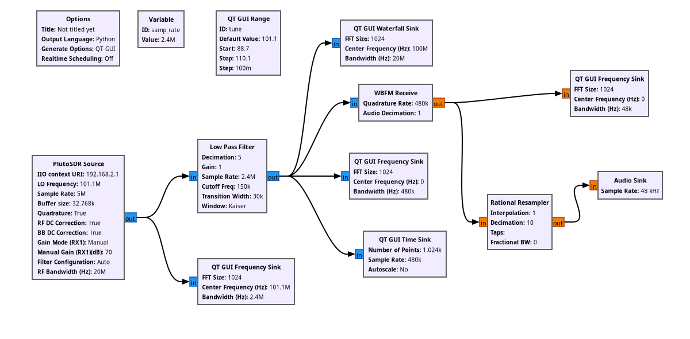
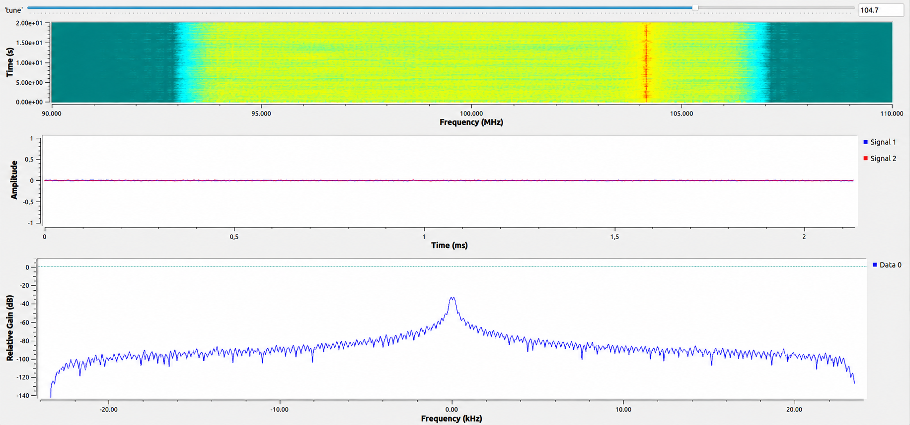
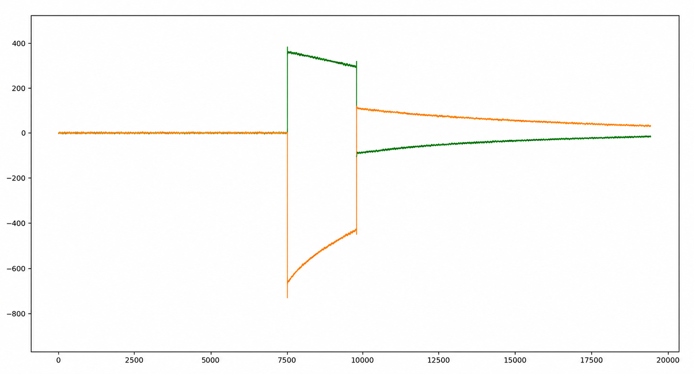

# SDR — Практические работы

Репозиторий содержит практические задания по изучению программно-определяемых радиосистем (Software Defined Radio). В ходе выполнения работ рассматриваются обработка радиосигналов в GNU Radio, взаимодействие с устройствами через SoapySDR, получение комплексных I/Q-отсчётов и организация передачи данных с использованием временных меток.

## Используемые технологии

- **GNU Radio Companion** — построение схем обработки радиосигналов.
- **SoapySDR** — программный интерфейс управления SDR-оборудованием.
- **C/C++** — реализация программ приёма и передачи.
- **Python, NumPy, Matplotlib** — обработка и визуализация полученных данных.
- **Ubuntu / WSL2** — среда разработки и запуска.

---

# Практические занятия №1–2
## Исследование SDR и разработка FM-приёмника

### Задача

Ознакомиться с принципами работы ADALM-Pluto и возможностями GNU Radio Companion. Разработать схему FM-приёмника, выполняющую фильтрацию, демодуляцию и отображение радиосигнала.

### Построение схемы

В GNU Radio Companion разработана схема обработки FM-сигнала.

В исходной аппаратной конфигурации источником данных служит PlutoSDR. Приём осуществляется с частотой дискретизации 2,4 МГц и центральной частотой 101,1 МГц.

Обработка сигнала выполняется последовательно:

1. Получение комплексных отсчётов от источника.
2. Выделение необходимой полосы частот с помощью фильтра низких частот.
3. Демодуляция FM-сигнала блоком `WBFM Receive`.
4. Преобразование частоты дискретизации для аудиовыхода.
5. Отображение спектра, водопада и временных характеристик.

Для анализа используются блоки `QT GUI Frequency Sink`, `QT GUI Waterfall Sink` и `QT GUI Time Sink`.

### Параметры конфигурации

| Параметр | Значение |
|---|---|
| Sample Rate | 2,4 МГц |
| LO Frequency | 101,1 МГц |
| Buffer Size | 32768 |
| RF Bandwidth | 20 МГц |
| Gain Mode | Manual |
| RX Gain | 70 дБ |

### Визуализация

*Рисунок 1 — Структура FM-приёмника, созданная в GNU Radio Companion.*

*Рисунок 2 — Спектральное представление, водопад и временные характеристики сигнала.*

### Итог

Разработана схема FM-приёмника с возможностью анализа сигнала на разных этапах обработки.

В аппаратном варианте предусмотрен приём радиостанции «Европа Плюс» на частоте 103,2 МГц. При отсутствии PlutoSDR схема может быть адаптирована для программной генерации FM-сигнала, однако такая симуляция не подтверждает приём реальной радиостанции.

---

# Практическое занятие №3
## Работа с SoapySDR и запись I/Q-данных

### Задача

Изучить программное взаимодействие с SDR через библиотеку SoapySDR. Реализовать получение цифровых отсчётов и их сохранение для последующего анализа.

### Программная реализация

Программа написана на C с использованием API библиотеки SoapySDR.

Работа приложения состоит из нескольких этапов:

1. Создание экземпляра SDR-устройства функцией `SoapySDRDevice_make()`.
2. Настройка параметров приёмного канала.
3. Создание RX-потока с форматом `SOAPY_SDR_CS16`.
4. Выделение буфера для хранения полученных отсчётов.
5. Чтение данных функцией `SoapySDRDevice_readStream()`.
6. Сохранение комплексных значений в бинарный PCM-файл.
7. Освобождение ресурсов устройства.

В файле `rxdata.pcm` данные хранятся в виде последовательности 16-битных целых чисел:

`I0, Q0, I1, Q1, I2, Q2, ...`

Каждая пара представляет один комплексный отсчёт.

### Рабочие параметры

| Характеристика | Значение |
|---|---|
| Частота дискретизации | 1 МГц |
| Центральная частота | 800 МГц |
| Формат данных | CS16 |
| Усиление RX | 40 дБ |
| Количество циклов чтения | 100 |
| Выходной файл | `rxdata.pcm` |

### Анализ записанных отсчётов

Для визуализации используется Python с библиотеками NumPy и Matplotlib.

После чтения бинарного файла значения разделяются на две составляющие:

- **I (In-phase)** — синфазная компонента.
- **Q (Quadrature)** — квадратурная компонента.

Обе составляющие отображаются на общем графике, что позволяет оценить изменение амплитуды и наличие отдельных всплесков.

*Рисунок 3 — Представление I/Q-отсчётов во временной области.*

### Итог

Подготовлена программа для получения I/Q-данных через SoapySDR и их сохранения в PCM-формате. Разработан скрипт для визуализации записанных отсчётов.

Для выполнения аппаратного приёма необходимо подключение совместимого SDR-устройства. Без него можно отдельно проверить формат файлов и обработку синтетических I/Q-данных.

---

# Практические занятия №4–5
## Совместная работа RX/TX и использование временных меток

### Задача

Исследовать возможности одновременного приёма и передачи данных в SDR-системе. Рассмотреть механизм синхронизации передачи по временным меткам и особенности обмена данными через USB.

### Особенности реализации

В программе используются два независимых потока:

- **RX Stream** — получение отсчётов.
- **TX Stream** — отправка подготовленного сигнала.

Для работы с временными метками предусмотрена модифицированная версия драйвера SoapyPlutoSDR.

При инициализации устройства задаются дополнительные параметры:

- `direct=1`
- `timestamp_every=1920`
- `loopback=0`

### Подготовка передаваемых данных

Передающий буфер содержит комплексные значения с фиксированными составляющими:

`I = 2000, Q = 2000`

Дополнительно в буфер помещаются служебные маркеры `0xFFFF` и информация о запланированном времени передачи.

Временная метка представляется в виде восьми байтов. При формировании служебной последовательности каждый байт сдвигается на четыре бита влево.

### Алгоритм обмена

1. Инициализируются RX- и TX-каналы.
2. Для каждого потока создаётся отдельный буфер.
3. Приёмник получает очередную порцию I/Q-данных.
4. Из результата чтения извлекается временная метка `timeNs`.
5. Рассчитывается момент отправки:

   `tx_time = timeNs + 4 000 000`

6. Подготовленная временная метка записывается в TX-буфер.
7. На третьей итерации выполняется передача с флагом `SOAPY_SDR_HAS_TIME`.
8. Принятые данные сохраняются для дальнейшего исследования.

Значение `4 000 000` соответствует задержке 4 мс при использовании наносекунд.

### Настройки RX/TX

| Параметр | Значение |
|---|---|
| Sample Rate | 1 МГц |
| LO Frequency | 800 МГц |
| Data Format | CS16 |
| RX Gain | 30 дБ |
| TX Gain | −40 дБ |
| Timestamp Interval | 1920 |
| TX Delay | 4 мс |
| Количество итераций | 10 |

### Результаты визуализации

Для исследования принятых данных используется график изменения I- и Q-составляющих.

*Рисунок 4 — Изменение комплексных отсчётов при выполнении теста RX/TX.*

### Итог

Реализован программный алгоритм совместной работы приёмного и передающего потоков с планированием передачи по временной метке.

Использование `SOAPY_SDR_HAS_TIME` позволяет запросить передачу в заданный момент времени при наличии соответствующей поддержки драйвера и оборудования. Фактическую точность синхронизации необходимо оценивать по результатам аппаратных измерений.

---

## Общие выводы

В ходе практических занятий были рассмотрены основные этапы разработки SDR-приложений: от построения FM-приёмника в GNU Radio до низкоуровневого взаимодействия с потоками I/Q-данных через SoapySDR.

Отдельное внимание уделено бинарному представлению комплексных отсчётов, их анализу в Python и механизму временных меток при организации передачи.

Программное моделирование позволяет изучить алгоритмы обработки без физического SDR-оборудования. Для проверки радиочастотного тракта, качества реального приёма и точности аппаратной синхронизации необходимы соответствующие устройства и экспериментальные измерения.