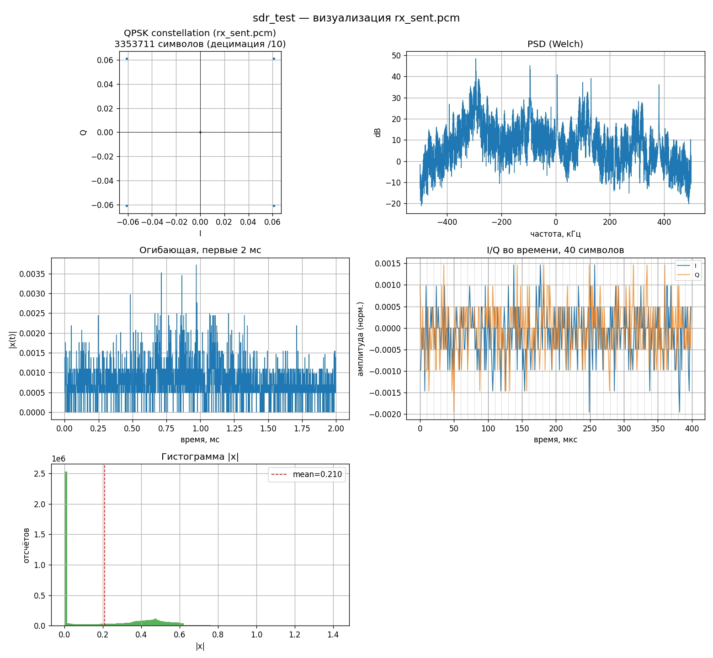

# PracticeSDR — практические работы по Software Defined Radio

Учебный проект по **программно-определяемому радио (SDR)**. В репозитории собраны отчёты по построению FM-приёмника, получению комплексных I/Q-отсчётов через SoapySDR, работе с потоками RX/TX и формированию цифровых сигналов BPSK/QPSK.

Рабочая среда — **Ubuntu / WSL2**; для задач с реальным радиоканалом предполагается использование **ADALM-PLUTO**. Часть результатов иллюстрируется сохранёнными графиками. Наличие графика само по себе не подтверждает успешную аппаратную передачу: проверка приёма требует логов и записи данных с RX-устройства.

## Содержание

| Недели | Тема | Отчёт | Иллюстрации |
|:---:|---|---|---|
| **1–2** | GNU Radio и FM-приёмник | [Открыть](reports/week_1_2/README.md) | [Схема](pics/scheme_week_1.png) · [Результат](pics/results_week_1.png) |
| **3** | SoapySDR: настройка RX, I/Q-отсчёты | [Открыть](reports/week_3/README.md) | [График I/Q](pics/graph_week_3.png) |
| **4** | RX/TX и временные метки | [Открыть](reports/week_4/README.md) | [График RX/TX](pics/graph_week_4.png) |
| **5–7** | Передача цифровых сигналов, BPSK/QPSK | [Открыть](reports/week_5_6_7/README.md) | [Анализ QPSK](pics/week_5_6_7_result.png) |
| **8** | Материалы не заполнены | `reports/week_8/README.md` | — |
| **9** | Материалы не заполнены | `reports/week_9/README.md` | — |

## Структура репозитория

```text
PracticeSDR/
├── README.md
├── CMakeLists.txt
├── src/
│   └── main.cpp                  # Текущая программа: BPSK/QPSK, RX/TX, timestamp
├── pics/
│   ├── scheme_week_1.png         # Блок-схема GNU Radio
│   ├── results_week_1.png        # Спектр и временные характеристики
│   ├── graph_week_3.png          # I/Q-отсчёты: неделя 3
│   ├── graph_week_4.png          # I/Q-отсчёты: неделя 4
│   └── week_5_6_7_result.png     # Составная визуализация цифрового сигнала
├── reports/
│   ├── week_1_2/README.md
│   ├── week_3/README.md
│   ├── week_4/README.md
│   ├── week_5_6_7/README.md
│   ├── week_8/README.md          # Пустой файл
│   └── week_9/README.md          # Пустой файл
└── .gitignore
```

В корне проекта находится **один актуальный исходник** [`src/main.cpp`](src/main.cpp). Он соответствует этапу **5–7**. Отдельные исторические версии программ для недель 3 и 4, а также `.grc`-схема первой работы в этом архиве отсутствуют; по этим темам доступны отчёты и изображения.

## Инструменты

- **GNU Radio Companion** — проектирование FM-приёмника, фильтрация и визуализация сигналов.
- **SoapySDR / libiio** — доступ к SDR-оборудованию и управление RX/TX-потоками.
- **C++ и CMake** — создание и сборка текущей программы.
- **Python, NumPy, Matplotlib** — чтение бинарных I/Q-данных и построение графиков (описаны в отчётах).
- **Ubuntu / WSL2, Git** — среда разработки и контроль версий.

---

## Недели 1–2 — FM-приёмник в GNU Radio

Первый этап посвящён архитектуре ADALM-PLUTO и построению тракта FM-приёма. Схема включает источник сигнала, фильтр нижних частот, `WBFM Receive`, преобразование частоты дискретизации и инструменты `QT GUI` для анализа спектра и временной формы.

В материалах рассматриваются фильтрация и децимация потока, а также согласование частот дискретизации перед демодуляцией и воспроизведением звука. Детальные параметры и особенности конфигурации приведены в [отчёте](reports/week_1_2/README.md).


*Рисунок 1 — Схема обработки FM-сигнала.*


*Рисунок 2 — Спектральные и временные представления сигнала.*

## Неделя 3 — получение I/Q-отсчётов

Изучается C API SoapySDR: создание SDR-устройства, выбор параметров приёма и чтение данных из потока `SOAPY_SDR_CS16`. Отсчёты представляются чередующимися 16-битными значениями синфазной (**I**) и квадратурной (**Q**) компонент.

Параметры, указанные в [отчёте](reports/week_3/README.md): **1 МГц** (Sample Rate), **800 МГц** (центральная частота), **40 дБ** (RX Gain), **100** циклов чтения. Результат анализируется в Python.


*Рисунок 3 — Временные характеристики I- и Q-компонент.*

## Неделя 4 — обмен RX/TX с временными метками

Следующий этап посвящён использованию приёмного и передающего потоков одновременно. В [отчёте](reports/week_4/README.md) рассматриваются работа с MTU-буферами, служебный заголовок передаваемого блока и планирование передачи относительно времени принятого пакета.

Для передачи используется `SOAPY_SDR_HAS_TIME`, а расчётное время отправки сдвигается на **4 мс** относительно метки RX-буфера. Аппаратная точность такого режима зависит от используемого устройства и драйвера.


*Рисунок 4 — График I/Q-данных, относящийся к тесту RX/TX.*

## Недели 5–7 — радиоканал и цифровая модуляция

На этом этапе используется [текущая программа `src/main.cpp`](src/main.cpp). Она создаёт два потока SoapySDR и поддерживает два режима запуска (`rx` и `tx`) с взаимно переставленными частотами передачи и приёма.

| Режим | Частота RX | Частота TX | Файл с подготовленными TX-данными |
|---|---:|---:|---|
| `rx` | 821 МГц | 766 МГц | `rx_sent.pcm` |
| `tx` | 766 МГц | 821 МГц | `tx_sent.pcm` |

Основные настройки программы:

| Настройка | Значение |
|---|---|
| Sample Rate | 1 МГц |
| Данные потока | `SOAPY_SDR_CS16` |
| Усиление RX / TX | 30 дБ / −40 дБ |
| Модуляция по умолчанию | QPSK (также реализована BPSK) |
| Отсчётов на символ | 10 |
| Формирование импульсов | Вставка нулей и свёртка с прямоугольным фильтром |
| Timestamp | `timestamp_every=1920` |
| Отступ времени TX | 4 мс |
| Остановка программы | `Ctrl+C` |

Последовательность битов преобразуется в символы BPSK либо QPSK, затем сигнал проходит апсемплинг и свёртку. При работе с устройством программа вычисляет статистику входного RX-потока и планирует TX с временной меткой.

**Важное различие:** файлы `rx_sent.pcm` / `tx_sent.pcm` содержат **сформированные TX-отсчёты**, а не запись фактически принятых RX-данных. Название файла зависит от выбранного режима. Подробное объяснение и ограничения эксперимента приведены в [отчёте за недели 5–7](reports/week_5_6_7/README.md).



*Рисунок 5 — Созвездие, спектральные характеристики, огибающая, I/Q-сигналы и распределение амплитуды.*

---

## Сборка и запуск

Для сборки используется файл [`CMakeLists.txt`](CMakeLists.txt) в корне проекта. Он собирает **текущую программу для недель 5–7**, а не отдельные приложения для каждого отчёта.

На Ubuntu / WSL2 установите основные инструменты:

```bash
sudo apt update
sudo apt install -y build-essential cmake libsoapysdr-dev soapysdr-tools
```

После установки совместимого модуля `plutosdr` и подключения устройства:

```bash
cmake -S . -B build
cmake --build build
```

**Перед сборкой:** в текущем архиве строка `#include <string.h> /` файла `src/main.cpp` содержит лишний символ `/`. Его нужно удалить, оставив `#include <string.h>`; сам исходник в этой версии архива не менялся.

Режимы запуска (из корня репозитория):

```bash
./build/main tx usb:0.1.5
./build/main rx usb:0.1.5
```

Если адрес устройства отличается, укажите URI, полученный из списка обнаруженных устройств. Оба режима создают RX- и TX-потоки: аргумент меняет их частоты, а не отключает один из потоков.

> **Ограничение:** для аппаратного запуска нужен совместимый PlutoSDR и драйвер с поддержкой используемых временных меток. Без устройства программа не выполнит реальный приём или передачу. Сохранённые изображения можно изучать независимо от оборудования.

## Итоги проекта

Репозиторий охватывает переход от графической обработки FM-сигнала в GNU Radio к управлению I/Q-буферами и программному формированию цифрового радиосигнала. На текущий момент доступны **четыре заполненных отчёта**, **пять изображений** и **одна актуальная C++-программа**. Материалы недель 8 и 9 пока представлены пустыми файлами-заготовками.
