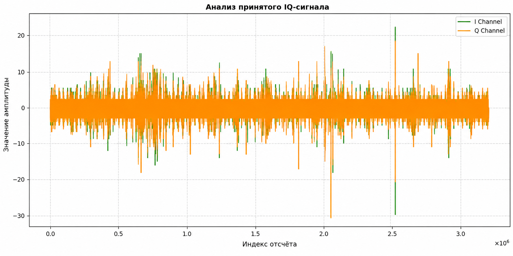

# Неделя 3 — Работа с SoapySDR и запись I/Q-отсчётов

## Цель работы

Познакомиться с программным интерфейсом SoapySDR, научиться задавать параметры приёмного канала ADALM-PLUTO и организовывать сохранение комплексных отсчётов в бинарный файл для дальнейшего анализа.

## Краткие теоретические сведения

В SDR-системах значительная часть обработки сигнала выполняется программно. После оцифровки радиосигнал представляется последовательностью комплексных отсчётов, каждый из которых содержит две составляющие:

- **I** (*In-phase*) — синфазная компонента;
- **Q** (*Quadrature*) — квадратурная компонента.

Библиотека **SoapySDR** предоставляет единый интерфейс для настройки SDR-устройств и обмена цифровыми данными. В работе используется формат `SOAPY_SDR_CS16`: каждый отсчёт хранится как пара знаковых 16-битных значений `I` и `Q`. Для одного комплексного отсчёта требуется 4 байта.

## Среда и программная реализация

Программа находится в файле `.cpp`, но использует C API библиотеки SoapySDR. Файл программы расположен по пути [`week_3/src/main.cpp`](../../week_3/src/main.cpp), а сборка описана в [`week_3/CMakeLists.txt`](../../week_3/CMakeLists.txt).

В коде для открытия устройства задаются `driver=plutosdr` и `uri=usb:`. Далее выполняется конфигурация только **приёмного потока (RX)**.

| Настройка | Значение |
|---|---|
| Драйвер устройства | `plutosdr` |
| Интерфейс подключения | `usb:` |
| Sample Rate | 1 МГц |
| Центральная частота RX | 800 МГц |
| Усиление | 40 дБ |
| Канал | 0 |
| Формат отсчётов | `SOAPY_SDR_CS16` |
| Количество попыток чтения | 100 |
| Файл с данными | `rxdata.pcm` |

## Порядок выполнения

### 1. Подключение и настройка приёмника

С помощью `SoapySDRDevice_make()` программа пытается открыть PlutoSDR. Если устройство не обнаружено, выводится сообщение об ошибке, после чего приложение завершает работу.

После подключения задаются частота дискретизации, частота настройки и усиление. Для приёма используется первый канал SDR (`channel 0`).

### 2. Создание потока данных

Функция `SoapySDRDevice_setupStream()` создаёт поток RX с 16-битными комплексными отсчётами. После активации потока определяется его MTU — максимальное количество комплексных отсчётов за одну операцию чтения.

Для хранения информации выделяется память размером `2 * MTU * sizeof(int16_t)`, так как каждый комплексный отсчёт включает две составляющие.

### 3. Чтение и сохранение I/Q

Программа выполняет до 100 операций чтения с помощью `SoapySDRDevice_readStream()`. При успешном получении данных в файл записывается именно то количество значений, которое вернула функция.

Формат сохранения:

```text
I0, Q0, I1, Q1, I2, Q2, ...
```

Файл `rxdata.pcm` записывается в бинарном виде и не содержит заголовка. Поэтому при его чтении необходимо отдельно знать формат данных и порядок компонентов.

### 4. Сборка и запуск

Из папки `week_3` проект можно собрать через CMake:

```bash
cmake -S . -B build
cmake --build build
cd build
./main
```

При запуске из папки `build` выходной файл будет создан по пути `build/rxdata.pcm` относительно корня `week_3`.

Для реального чтения необходим подключённый ADALM-PLUTO с совместимым драйвером SoapySDR. Без устройства программу можно собрать и изучить, но фактическая запись RX-данных не произойдёт.

## Анализ данных

Для просмотра I/Q-отсчётов используется Python с библиотеками NumPy и Matplotlib. При чтении файла массив разделяется на две последовательности: элементы с чётными индексами относятся к I, с нечётными — к Q.



*Рисунок 1 — Визуализация I- и Q-составляющих. Иллюстрация взята из ранее предоставленного изображения; она не является самостоятельным подтверждением аппаратного приёма.*

По временным диаграммам можно оценивать разброс значений, наличие импульсных всплесков и поведение обеих компонент. При этом одного графика недостаточно для подтверждения исправности радиочастотного тракта.

## Результат и вывод

В ходе работы разработана программа, которая настраивает приёмный канал PlutoSDR через SoapySDR, создаёт поток `CS16`, выделяет буфер и сохраняет полученные I/Q-отсчёты в файл для анализа. Дополнительно рассмотрен способ их визуализации средствами Python.

Данная реализация посвящена **только приёму (RX)**. Передача (TX), формирование временных меток и запуск с `SOAPY_SDR_HAS_TIME` относятся к следующему этапу проекта — `week_4` — и в этом отчёте не рассматриваются. Поскольку аппаратный SDR в используемой среде отсутствует, фактическое получение данных от PlutoSDR требует отдельной проверки на оборудовании.
