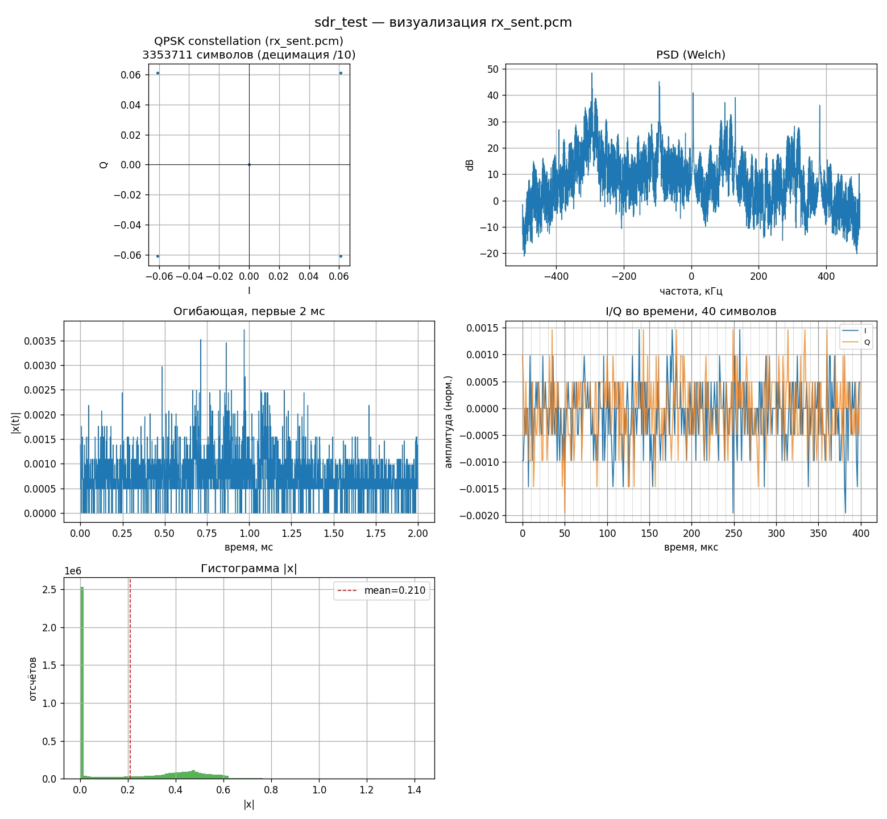

# Отчёт: Недели 5–7 — Передача цифровых сигналов между ADALM-PLUTO

## 1. Цель работы

Продолжить изучение SoapySDR и организовать обмен комплексными I/Q-отсчётами между двумя устройствами ADALM-PLUTO. Разработать программу с выбором направления радиоканала, подготовкой сигнала BPSK/QPSK, передачей с временной меткой и анализом сформированных данных.

## 2. Средства разработки и оборудование

Для практики используются:

- два ADALM-PLUTO (для аппаратного обмена между независимыми приёмопередатчиками);
- библиотека **SoapySDR**, драйвер `plutosdr` с поддержкой временных меток;
- **C++** и файл [`src/main.cpp`](../../src/main.cpp);
- **CMake** для сборки;
- средства визуализации I/Q-данных, представленные на сохранённом графике.

В программной конфигурации используется интерфейс USB, формат `SOAPY_SDR_CS16` и дополнительный параметр драйвера `timestamp_every=1920`. Фактический обмен по радио требует двух подключённых устройств; исходный код и сохранённый график сами по себе не подтверждают проведение такого испытания.

## 3. Организация радиоканала

На обоих компьютерах предполагается использовать одну программу, а режим выбирать аргументом при запуске:

```bash
./build/main rx [uri]
./build/main tx [uri]
```

Аргумент `uri` необязателен: по умолчанию задан `usb:0.1.5`. Он обозначает подключённое **локальное** SDR-устройство, а не адрес второго компьютера.

Программа одновременно создаёт RX- и TX-потоки в каждом режиме, но меняет их рабочие частоты. Благодаря этому передача одного устройства может попадать в полосу приёма другого:

| Режим | RX | TX | Файл подготовленных TX-отсчётов |
|---|---:|---:|---|
| `rx` | 821 МГц | 766 МГц | `rx_sent.pcm` |
| `tx` | 766 МГц | 821 МГц | `tx_sent.pcm` |

Общие параметры программы:

| Параметр | Значение |
|---|---|
| Частота дискретизации RX/TX | 1 МГц |
| Формат данных | CS16 (I и Q по 16 бит) |
| RX Gain | 30 дБ |
| TX Gain | −40 дБ |
| Количество отсчётов на символ | 10 |
| Амплитуда символа до масштабирования | 2000 |
| Модуляция в текущем исходнике | QPSK (`SELECTED_MODULATION`) |
| Период вывода статистики | 250 буферов |
| Отступ запланированной передачи | 4 мс |
| Дополнительные аргументы | `direct=1`, `timestamp_every=1920`, `loopback=0` |

Размеры RX/TX-буферов определяются во время работы функцией `SoapySDRDevice_getStreamMTU()` и не обязательно равны 1920 отсчётам.

## 4. Ход работы

### 4.1. Подключение и настройка устройства

Программа создаёт объект SDR через `SoapySDRDevice_make()`, устанавливает частоты и усиление, затем открывает два потока формата CS16. Перед основной обработкой выполняются 128 успешных операций чтения для начального заполнения и прогрева приёмного тракта.

### 4.2. Формирование цифрового сигнала

В текущей реализации биты генерируются программно, затем отображаются в комплексные символы:

- **BPSK:** изменяется знак I-компоненты, Q равна нулю;
- **QPSK:** знаки I и Q выбираются независимо по двум битам на символ.

На один символ приходится десять отсчётов. Между символами сначала вставляются нулевые отсчёты, затем применяется свёртка с фильтром из десяти единиц. Перед записью в TX-буфер значения масштабируются в 16 раз. В начало буфера помещаются служебные слова `0xFFFF` и место для временной метки.

### 4.3. Приём и планирование передачи

При обработке очередного RX-буфера считывается `receive_time_ns`. Программа рассчитывает время передачи по формуле:

```cpp
long long scheduled_time_ns = previous_time_ns + 4 * 1000 * 1000;
```

Перед отправкой восемь байтов этого значения упаковываются в зарезервированную область TX-буфера. Вызов `SoapySDRDevice_writeStream()` выполняется с флагом `SOAPY_SDR_HAS_TIME` — программа запрашивает передачу через **4 мс** относительно метки принятого блока.

Передача запрашивается на каждой успешной итерации основного цикла, а не только на чётных буферах. Работа продолжается до остановки комбинацией **Ctrl+C**.

Параллельно вычисляются максимальная амплитуда приёмных I/Q-отсчётов и приблизительное смещение частоты по разности фаз соседних отсчётов. Статистика выводится в терминал каждые 250 буферов.

### 4.4. Сохранение данных

Программа создаёт файл `rx_sent.pcm` либо `tx_sent.pcm`, в зависимости от режима. В него записывается **содержимое подготовленного TX-буфера без служебного заголовка**, приведённое к исходному масштабу делением на 16.

Это важно: в текущем `main.cpp` принятый через `readStream()` RX-буфер **не сохраняется** в PCM-файл. Для отдельного анализа реального радиоприёма потребуется добавить запись RX-отсчётов и, желательно, сравнение переданной и принятой последовательностей.

## 5. Результаты и визуализация

В проекте сохранён один составной график, который объединяет несколько способов анализа данных из файла `rx_sent.pcm`:



*Рисунок 1 — Диаграмма созвездия QPSK, оценка спектральной плотности мощности, огибающая, I/Q-отсчёты во времени и гистограмма амплитуды.*

На изображении представлены:

1. **Созвездие QPSK** — четыре характерных положения комплексных символов на плоскости I/Q; в центре также наблюдается точка около нуля.
2. **PSD (Welch)** — оценка распределения мощности сигнала по частотам.
3. **Огибающая** — изменение модуля сигнала на первых 2 мс.
4. **I/Q во времени** — две компоненты на участке 40 символов.
5. **Гистограмма |x|** — распределение амплитуд и отмеченное среднее значение.

Скриншот подтверждает наличие визуализации подготовленных комплексных данных. Он **не позволяет сам по себе сделать вывод об отсутствии потерь RX-буферов, качестве связи между двумя платами или точности аппаратного timestamp**: для этих утверждений нужны журналы работы и отдельная запись полученного радиосигнала.

## 6. Сборка и запуск

Проект использует корневой файл [`CMakeLists.txt`](../../CMakeLists.txt). Сборка из корня репозитория:

```bash
cmake -S . -B build
cmake --build build
```

Примеры запуска на двух компьютерах при наличии поддерживаемых устройств:

```bash
# Компьютер A
./build/main tx usb:0.1.5

# Компьютер B
./build/main rx usb:0.1.5
```

В обоих режимах включены RX и TX, но используются противоположные пары частот. Для реального запуска необходимо установить SoapySDR и совместимый модуль PlutoSDR с требуемыми функциями timestamp.

## 7. Вывод

В ходе работы реализован программный тракт формирования цифровых символов BPSK/QPSK, расширения числа отсчётов на символ и импульсной фильтрации. Также в программе предусмотрены настройка двух потоков SoapySDR, обмен данными в формате CS16 и запрос передачи с задержкой по временной метке.

Подготовленные I/Q-данные можно анализировать в виде созвездия, спектра, временных диаграмм и распределения амплитуд. Следующий этап проверки — запись **фактически принятых** RX-отсчётов и сопоставление их с TX-данными при работе двух физических устройств.
