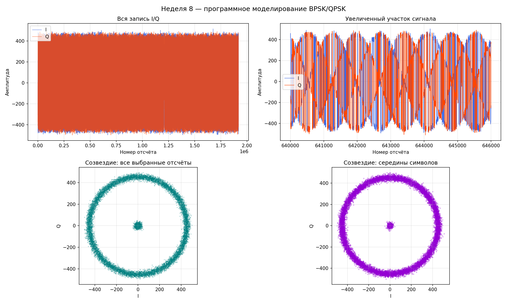

# Неделя 8 — Цифровой передатчик BPSK/QPSK и моделирование радиоканала

## 1. Цель работы

Изучить программное формирование BPSK- и QPSK-сигналов: преобразование битов в комплексные символы, увеличение количества отсчётов и импульсную фильтрацию. Исследовать влияние шума и расстройки несущей на временные диаграммы I/Q и сигнальное созвездие.

Эта практика продолжает [работы недель 5–7](../week_5_6_7/README.md). Передатчик реализован на C++/SoapySDR, а приёмные данные для отчёта получены **программным моделированием без физического ADALM-PLUTO**.

## 2. Материалы проекта

В работе используются следующие файлы:

- [`src/main.cpp`](../../src/main.cpp) — алгоритмы BPSK/QPSK, подготовка кадров и работа с потоками SDR;
- [`CMakeLists.txt`](../../CMakeLists.txt) — конфигурация сборки;
- `build/simulated/txdata.pcm` — синтетические отсчёты после прохождения виртуального канала;
- `build/simulated/tx_sent.pcm` — сохранённые отсчёты передаваемого сигнала;
- `build/simulated/simulation.json` — параметры эксперимента;
- [`pics/week8_results.png`](../../pics/week8_results.png) — графики временной области и созвездий.

В приложенном архиве находятся данные и рисунок, но **сам Python-скрипт генерации модели отсутствует**. Поэтому дальнейшее воспроизведение потребует добавить его в проект.

## 3. Формирование сигнала

### 3.1. Основные параметры

| Настройка из `main.cpp` | Значение | Описание |
|---|---:|---|
| `SYMBOL_SAMPLES` | 10 | отсчётов на один символ |
| `SYMBOL_AMPLITUDE` | 2000 | амплитуда каждой I/Q-компоненты до масштабирования |
| `FRAME_PREFIX_SAMPLES` | 6 | комплексных отсчётов служебного заголовка |
| `SELECTED_MODULATION` | `TX_QPSK` | модуляция по умолчанию; BPSK тоже поддерживается |
| `RADIO_SAMPLE_RATE` | 1 МГц | частота дискретизации RX/TX |
| `RECEIVER_GAIN` | 30 дБ | усиление RX в аппаратной конфигурации |
| `TRANSMITTER_GAIN` | −40 дБ | усиление TX в аппаратной конфигурации |
| `TX_ADVANCE_NS` | 4 000 000 нс | задержка запланированной передачи 4 мс |

### 3.2. Порядок обработки

Передатчик построен как последовательность операций:

```text
Генерация битов
      ↓
Модуляция BPSK/QPSK
      ↓
Вставка 9 нулей после символа
      ↓
Свёртка с прямоугольным фильтром
      ↓
Масштабирование I/Q → TX-буфер
```

Функция `fill_random_bits()` создаёт значения 0 или 1 с помощью `rand() % 2`. В BPSK один бит управляет знаком I, а Q равна нулю. В QPSK используются два бита:

| Пара бит | I | Q |
|:---:|---:|---:|
| `00` | +A | +A |
| `01` | +A | −A |
| `10` | −A | +A |
| `11` | −A | −A |

Для увеличения количества отсчётов функция `insert_zero_samples()` добавляет девять нулевых комплексных значений между соседними символами. Далее `apply_pulse_filter()` выполняет свёртку с коэффициентами из десяти единиц. Благодаря этому символ занимает **10 отсчётов одинакового уровня**.

В `fill_transmit_frame()` данные помещаются после заголовка. Если MTU равен 1920, в кадр умещаются `(1920 − 6) // 10 = 191` символ, то есть 1910 отсчётов полезной последовательности. Четыре оставшихся отсчёта обнуляются. Перед передачей значения компонентов умножаются на 16: например, 2000 становится 32000, что помещается в `int16_t`.

### 3.3. RX/TX и временные метки

В программе предусмотрены два режима: `rx` использует частоты **821 МГц для приёма и 766 МГц для передачи**, а `tx` — наоборот. При этом в обоих режимах создаются потоки RX и TX.

Служебная область содержит маркеры `0xFFFF` и восемь слов с байтами временной метки. После получения буфера RX запланированное время передачи задаётся как `receive_time_ns + 4 000 000`, а вызов `SoapySDRDevice_writeStream()` использует `SOAPY_SDR_HAS_TIME`. Перед основным циклом пропускаются 128 успешных чтений; каждые 250 буферов выводятся амплитуда и приблизительная оценка частотной расстройки.

**Важно:** файл `rx_sent.pcm` либо `tx_sent.pcm`, который создаёт этот C++-код, содержит *подготовленные TX-отсчёты* без заголовка. Он не является записью физического RX-канала.

## 4. Эксперимент без SDR-оборудования

Для анализа цифрового сигнала использована программная модель канала. Параметры подтверждаются файлом `build/simulated/simulation.json`:

| Показатель | Значение |
|---|---:|
| Модуляция | QPSK |
| Частота дискретизации | 1 МГц |
| Отсчётов на символ | 10 |
| Размер кадра | 1920 I/Q-отсчётов |
| Количество кадров | 1000 |
| Расстройка несущей | −350 Гц |
| Коэффициент передачи | 0,01 |
| Уровень шума (`noise_std`) | 15 |
| Пропуск кадров в модели | 25 |
| Фиксированное зерно генератора (`seed`) | 42 |

Сохранённый `txdata.pcm` занимает 7 680 000 байт и содержит **1 920 000 комплексных отсчётов** в формате CS16 (чередующиеся знаковые 16-битные I и Q, little-endian). При 1 МГц длина такой записи — **1,92 секунды**.

Частотный сдвиг −350 Гц приводит к вращению фазы сигнала. Аддитивный шум расширяет распределение точек созвездия, а заданные в модели пропуски кадров дают участки с пониженной амплитудой. Эти воздействия задаются программно и не являются измерениями реального радиоканала.

## 5. Результаты и графики



*Рисунок 1 — Вся I/Q-запись, увеличенный участок сигнала, созвездие выбранных отсчётов и созвездие по серединам символов.*

На общем рисунке показаны четыре представления данных:

1. **Вся запись I/Q.** На интервале примерно от 0 до 1,92 млн отсчётов обе компоненты образуют плотную полосу; особенности отдельных символов на таком масштабе неразличимы.
2. **Приближение по времени.** На участке около `640000–646000` отсчётов заметны быстрые переключения значений I/Q и изменение огибающей на фоне частотной расстройки.
3. **Созвездие всех выбранных отсчётов.** Вместо неподвижных точек QPSK наблюдается кольцо и небольшое облако около начала координат.
4. **Отсчёты из центров символов.** Кольцевая форма остаётся даже после выбора центрального значения символа, поскольку компенсация частоты и фазы ещё не выполнялась.

Изображение иллюстрирует ожидаемое поведение модели с частотным смещением и шумом. На этом этапе **декодирование битов и вычисление BER ещё не выполнены**.

## 6. Сборка и проверка

C++-проект собирается из корневого каталога:

```bash
cmake -S . -B build
cmake --build build
```

При наличии двух совместимых устройств можно использовать команды `./build/main tx usb:0.1.5` и `./build/main rx usb:0.1.5`. Без PlutoSDR аппаратные функции программы не запускаются.

Проверить уже сохранённый результат моделирования можно отдельно:

```python
import numpy as np

data = np.fromfile('build/simulated/txdata.pcm', dtype='<i2')
print('Комплексных отсчётов:', len(data) // 2)
```

При запуске кода из корня проекта должно выводиться `1920000`.

## 7. Вывод

В ходе восьмой практики рассмотрены этапы формирования цифрового сигнала: генерация битов, модуляция BPSK/QPSK, upsampling и свёртка с прямоугольным фильтром. Подготовленный TX-кадр может передаваться с временной меткой через SoapySDR при наличии подходящего оборудования.

Для программной проверки без ADALM-PLUTO использована модель канала QPSK с добавленным шумом, затуханием и сдвигом несущей. Результаты представлены временными диаграммами и созвездиями. Следующий этап — компенсация частотной расстройки, символьная синхронизация, демодуляция и оценка доли ошибочных битов.

**Ограничение:** результаты подтверждают работу модели, но не доказывают выполнение аппаратного обмена между двумя PlutoSDR, отсутствие потерь USB-буферов или точность аппаратных временных меток.
