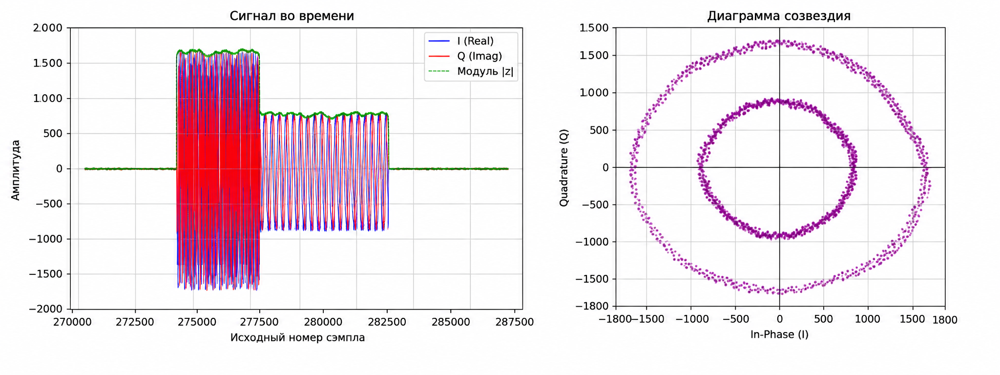
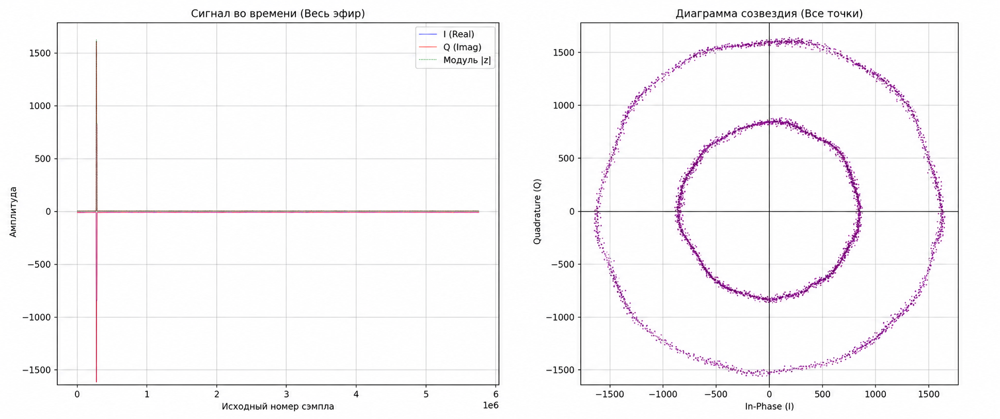

# Неделя 9 — Приём BPSK и восстановление символьной синхронизации

На девятом этапе практики основной акцент перенесён с формирования модулированного сигнала на его **обработку после приёма**. Для проверки алгоритмов используется фиксированная BPSK-последовательность, согласованный фильтр и схема восстановления моментов выборки на основе ошибки Гарднера. Поскольку аппаратный PlutoSDR недоступен, основным способом проверки служит программная модель радиоканала.

> **Статус эксперимента.** Графики и файлы в этом репозитории относятся к программному моделированию. Они не являются измерениями с реального радиоустройства.

## 1. Задача и отличие от недели 8

На [восьмой неделе](../week_8/README.md) исследовались формирование BPSK/QPSK и влияние канала на I/Q-отсчёты. Теперь передатчик использует одну фиксированную последовательность, а приёмная часть решает другую задачу: определить, **в какие моменты следует считывать символы**, чтобы уменьшить влияние переходов между ними.

Работа включает четыре этапа: подготовку BPSK-кадра, моделирование или захват комплексных отсчётов, фильтрацию принятых данных и коррекцию символьного времени.

## 2. Где находятся материалы

Пути указаны относительно корня `PracticeSDR/`.

| Файл | Назначение |
|---|---|
| [`src/main.cpp`](../../src/main.cpp) | Формирование BPSK, модель канала, согласованный фильтр и восстановление времени символов |
| [`CMakeLists.txt`](../../CMakeLists.txt) | Сборка C++-программы с SoapySDR |
| [`pics/week_9_1.png`](../../pics/week_9_1.png) | Первый график девятой недели |
| [`pics/week_9_2.png`](../../pics/week_9_2.png) | Второй график девятой недели |

В архиве нет отдельного скрипта, который заново строит изображения `week_9_1.png` и `week_9_2.png`. Поэтому рисунки приведены как уже сохранённые иллюстрации, без утверждения об автоматической генерации их текущим `main.cpp`.

## 3. Цепочка обработки

```text
Текст «PracticeSDR!»
        │
        ▼
    Биты (MSB → LSB)
        │
        ▼
 BPSK: 0 → +1500, 1 → −1500
        │
        ▼
   10 отсчётов на бит
        │
        ▼
  Модель канала / PlutoSDR
        │
        ▼
       I/Q (CS16)
        │
        ├──► rxdata.pcm
        │
        ▼
 Скользящее среднее (10 отсчётов)
        │
        ▼
 Начальная оценка фазы выборки
        │
        ▼
 Интерполяция + ошибка Гарднера
        │
        ▼
   Отсчёты в моменты символов
```

### Передаваемая последовательность

В функции `makeFrame()` текст `PracticeSDR!` преобразуется в биты, начиная со старшего бита каждого байта. В строке 12 ASCII-символов, то есть **96 бит**. Для каждого бита формируется десять одинаковых отсчётов по оси I, а Q остаётся нулевой. Таким образом, информационная часть занимает **960 комплексных отсчётов**. Перед ней размещены шесть служебных комплексных отсчётов. Остаток кадра заполняется нулями.

Уровень ±1500 масштабируется в буфере передачи до ±24000 (`int16_t`), что соответствует используемому в программе представлению CS16. Частота дискретизации установлена в **1 МГц**, а частота настройки устройства — **800 МГц**.

### Приёмный фильтр

`averageSymbols()` реализует согласование с прямоугольным импульсом через скользящую сумму десяти отсчётов:

\[
y[n] = \frac{1}{10}\sum_{k=0}^{9}x[n-k].
\]

Операция выполняется для комплексных данных и сглаживает быстрые шумовые изменения. На границах символов остаются переходные участки — поэтому одного фильтра недостаточно для надёжного выбора бита.

### Восстановление символьного времени

В `recoverTiming()` сначала сравниваются десять вариантов начального смещения, соответствующих десяти отсчётам на символ. Затем используется ошибка Гарднера:

\[
e_k = \operatorname{Re}\left\{(y_k-y_{k-1})y^*_{k-1/2}\right\}.
\]

Ошибка нормируется по энергии соседних символов и ограничивается по модулю. Пропорциональная и накопительная коррекции изменяют следующий момент выборки. Для дробного положения между отсчётами функция `sampleAt()` использует **линейную интерполяцию** — это более простая реализация, чем кубическая интерполяция.

Алгоритм выводит оценку фазы, среднюю абсолютную ошибку и число отсчётов, на которых выполнялась коррекция. **Отдельного признака устойчивого захвата (`locked`) и декодирования сообщения в текущем коде нет.**

## 4. Два режима запуска

**Без SDR-платы:**

```bash
./main offline
```

Программа формирует BPSK-кадр, пропускает его через модель с частотным сдвигом **+320 Гц**, аддитивным шумом (`σ = 13`) и масштабированием амплитуды `0.018`. Модель повторяет кадр **300 раз**. На выходе создаётся `rxdata.pcm` в **текущем рабочем каталоге** и печатается статистика символьной синхронизации.

**С PlutoSDR (при наличии совместимого устройства и драйвера):**

```bash
./main pluto usb:
```

Программа создаёт потоки RX/TX на 800 МГц, читает до 300 буферов и периодически планирует передачу на 4 мс позже временной метки принятого буфера. Этот режим здесь не проверялся на оборудовании.

## 5. Сохранённые данные и графики

### Иллюстрация 1 — участок сигнала и созвездие



*Рисунок 1. Сохранённая визуализация I/Q-сигнала и распределения комплексных отсчётов.*

### Иллюстрация 2 — расширенное представление



*Рисунок 2. Дополнительное представление временных данных и созвездия.*

При интерпретации созвездия важно учитывать расстройку несущей: даже при BPSK точки могут вращаться в комплексной плоскости, а не образовывать две неподвижные группы. Паузы в передаче, шум и особенности модели также влияют на распределение амплитуд. Наличие кольцевых структур само по себе не доказывает аппаратную утечку гетеродина.

### Почему параметры сохранённого PCM отличаются от текущего `offline`

В архиве имеется **другой, ранее сформированный набор** сохранённых комплексных отсчётов с параметрами отдельного моделирования:

| Параметр сохранённого набора | Значение |
|---|---:|
| Частота дискретизации | 1 МГц |
| Модуляция | BPSK |
| Отсчётов на символ | 10 |
| Длина кадра | 1920 комплексных отсчётов |
| Количество кадров | 1000 |
| Частотный сдвиг | −350 Гц |
| Стандартное отклонение шума | 15 |
| Начальное смещение времени | 2,85 отсчёта |
| Дрейф синхронизации | 1,2 ppm |
| Зафиксировано пропусков кадров | 28 |

Размер файла составляет **7 680 000 байт**, что соответствует **1 920 000 комплексных отсчётов** в формате `int16 I, int16 Q`. Эти данные **не следует приписывать текущему режиму `offline`**: он использует другие значения шума, частотной расстройки и количества повторений.

Для быстрой проверки числа отсчётов сохранённого файла:

```bash
python3 - <<'PY'
import numpy as np
samples = np.fromfile('rxdata.pcm', dtype='<i2')
print('Комплексных отсчётов:', samples.size // 2)
PY
```

Ожидаемый результат для файла из архива: `1920000`.

## 6. Что удалось реализовать и что осталось

В девятой работе подготовлен воспроизводимый BPSK-кадр, добавлена программная модель приёмного канала, реализованы согласованная фильтрация, начальная оценка фазы выборки и контур коррекции по Гарднеру. Результаты можно изучать без физического SDR-устройства.

Для следующего этапа остаются компенсация частотной и фазовой ошибки, восстановление битов, сравнение принятой последовательности с исходным текстом и расчёт BER. Кроме того, алгоритм символьной синхронизации следует проверить на разных уровнях шума и дрейфа времени, а аппаратный режим — отдельно испытать на PlutoSDR.
